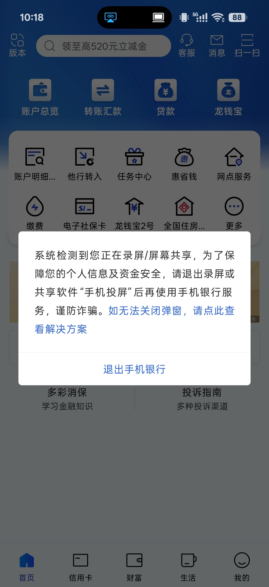
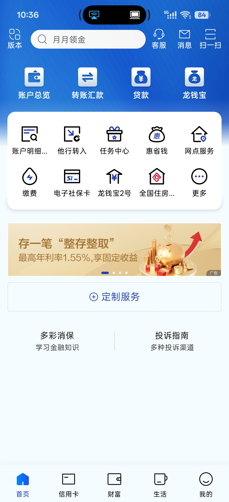

# 屏幕自由 ScreenUnlock

解除受保护界面的截图与录屏限制，屏蔽系统下发的截图、录屏检测回调，并隐藏 OPPO 互联投屏在系统里留下的公开显示设备。

## 关于原仓库

本项目基于 [LSPosed/DisableFlagSecure](https://github.com/LSPosed/DisableFlagSecure)（现名 Enable Screenshot）二次开发，遵循上游的[GNU GPL v3](LICENSE) 。

上游解决的是「内容能不能被截到」：解除 `FLAG_SECURE`、强制捕获安全图层、屏蔽各家 ROM 的截图拦截判断。本项目保留其全部能力，并补充了一项上游没有覆盖的方向——「屏幕正在共享」这件事本身的可观测性。

## 功能

- **解除截图限制**：让设置了 `FLAG_SECURE` 的窗口可以被截图、录屏采集到内容
- **屏蔽截图检测**：切断 `ActivityTaskManagerService#registerScreenCaptureObserver`，Android 14+ 的截图回调不再通知应用
- **屏蔽录屏检测**：切断 `WindowManagerService#registerScreenRecordingCallback`，Android 15+ 的录屏回调不再通知应用
- **隐藏 OPPO 互联投屏显示**：把投屏创建的虚拟屏标记为私有，第三方应用无法枚举到它
- **厂商适配**：OPPO、小米 HyperOS、三星 OneUI、魅族的截图流程同步处理
- **API102**：基于 libxposed API 102 开发

## 与上游的差异

### 新增：隐藏 OPPO 互联投屏显示

上游模块生效后，OPPO 互联投屏时第三方应用仍能检测到正在投屏。原因是 OPPO 的跨屏互联服务 `com.oplus.cast` 创建虚拟屏时传入了 `VIRTUAL_DISPLAY_FLAG_PUBLIC`，该显示对系统内所有应用可见。任何应用只要调用一次 `DisplayManager#getDisplays()`，发现除默认屏之外还有一块显示，就能判断用户在投屏。

本项目的改动是在 `VirtualDisplayAdapter#createVirtualDisplayLocked` 中，对 caller 为 `com.oplus.cast` 的请求清除 `VIRTUAL_DISPLAY_FLAG_PUBLIC`，使该显示转为私有。私有的判定逻辑在 `Display#hasAccess()`：只允许显示属主、system uid 以及内容正显示在该屏上的 uid 访问，其余应用拿到的是 `null`。

两个实现要点：

- 上游原有的提前返回条件是「调用方非系统 uid 且非 MediaProjection 时直接放行」，`com.oplus.cast` 正好落在这一区间，不做处理则新逻辑不会执行，因此对该包名做了例外
- 只清除 `PUBLIC` 而保留 `AUTO_MIRROR`，镜像行为不受影响，投屏画面正常，只是这块显示的存在性对外界隐藏

诊断方面，每当有公开虚拟屏被创建时会输出一行日志，包含调用方包名和改写前后的 flags：

```
vdisplay pkg=com.oplus.cast flags=0x27 -> 0x26
```

日志 tag 为 `ScreenUnlock`，可通过 `adb logcat -s ScreenUnlock` 或 LSPosed 管理器的日志页查看。

实际效果，以中国建设银行 App 在 OPPO 互联投屏状态下为例。左图为使用模块前，应用弹出安全提示并要求退出手机银行；右图为使用模块后，界面正常，不再出现提示。

| 使用模块前 | 使用模块后 |
|---|---|
|  |  |

## 支持范围

- Android 12 至 17
- 小米 HyperOS
- OPlus OS（ColorOS、Realme UI、OxygenOS）
- 三星 One UI
- **不支持**自定义 ROM
- **不支持**非官方 LSPosed 构建

隐藏投屏显示仅覆盖 `com.oplus.cast`。其他投屏方式（USB 有线、第三方投屏应用、其他厂商互联工具）仍会暴露公开虚拟屏。

该特性在 OPPO 设备（Android 17）上验证通过：投屏画面与系统状态正常，第三方应用枚举不到该显示。其余能力继承自上游，验证范围以上游为准。

## 使用方法

1. 安装 APK
2. 在 LSPosed 管理器中启用模块
3. 重启手机

## 构建

需要 JDK 21 与 Android SDK（compileSdk 37）。

```bash
./gradlew assemble
```

APK 输出在 `app/build/outputs/apk/`。仓库的 GitHub Actions 会在 push 到 main 时自动构建，构建产物可直接下载。

## 许可

[GNU GPL v3](LICENSE)  
**本项目保留上游的 LICENSE 与版权声明，上游版权归 LSPosed 贡献者所有**
